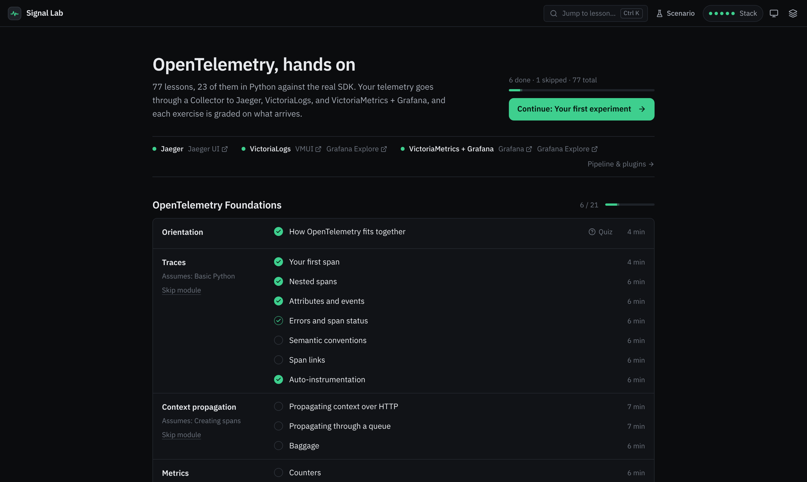
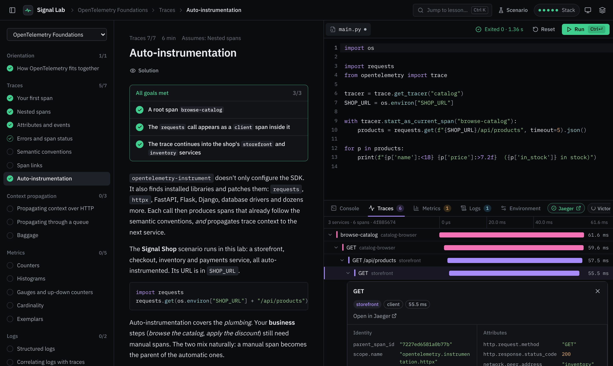
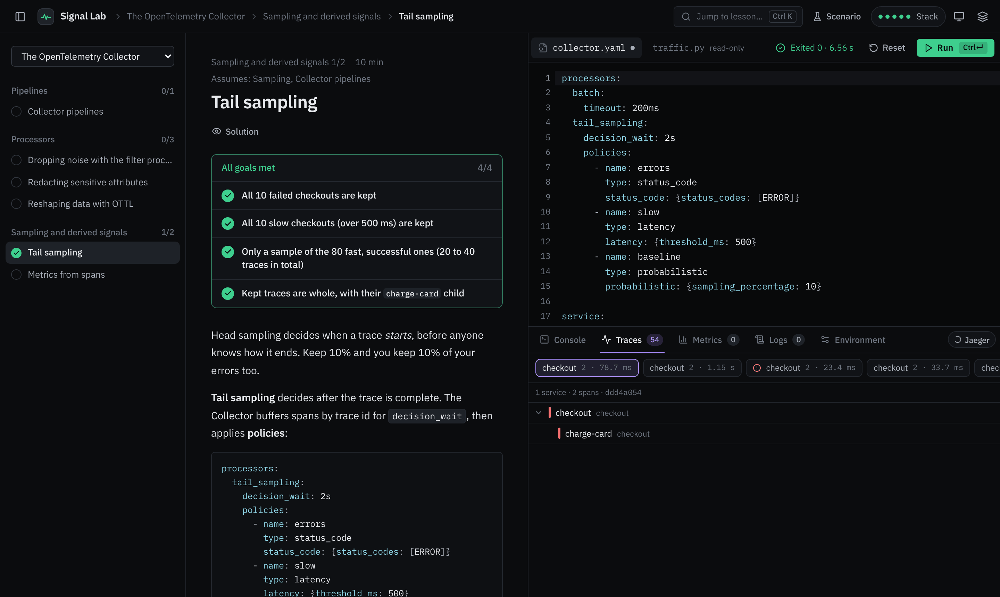
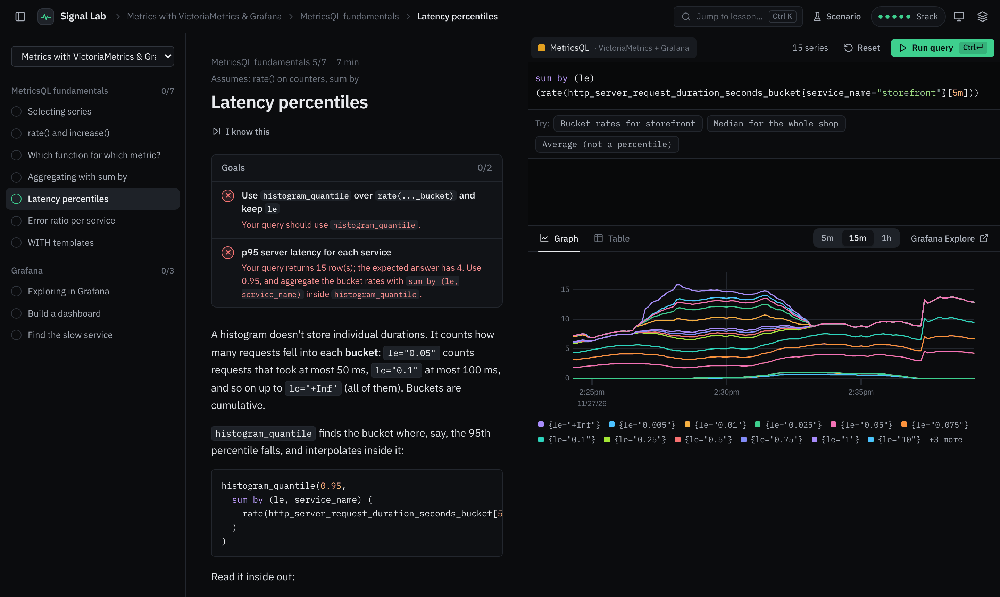
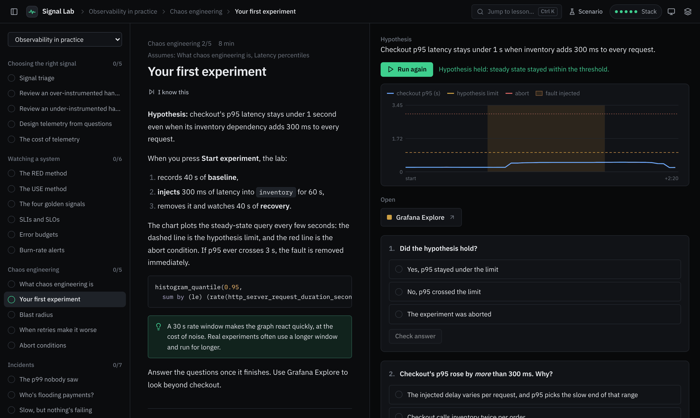
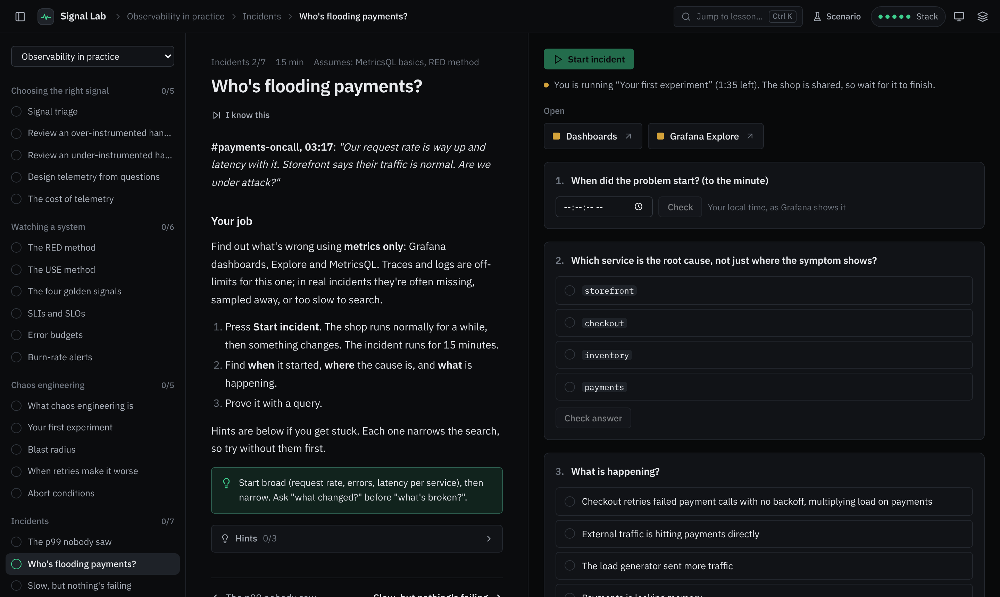

# Signal Lab

An interactive course for learning OpenTelemetry and investigating systems
with it. You write Python against the real OpenTelemetry SDK, send telemetry
through a real Collector into real backends, and each exercise is graded on
the telemetry that actually arrives.



## Why it exists

Most observability training stops at "here's a config file". Signal Lab makes
you do the work and shows the result immediately:

- **Real tools.** Your code runs as `opentelemetry-instrument python main.py`.
  The Collector, VictoriaMetrics, VictoriaLogs, Jaeger, Grafana and Elastic are
  the real products, not imitations.
- **Instant feedback.** A built-in inspector shows every span, metric and log
  the moment the Collector forwards it, then confirms when each backend has
  indexed it, with a link straight to it.
- **Graded on telemetry.** Checks read what you exported: "a `client` span whose
  parent is `checkout`", "at most 6 time series", "every log carries a trace id".
  A failing check says what it saw instead.
- **Judgment, not just syntax.** The later tracks teach when to emit a metric,
  a span, a log, or nothing at all; how to run a chaos experiment safely; and
  how to find the cause of an incident from metrics alone.
- **Skip what you know.** Tracks are split into modules and lessons that stand
  alone. Mark any of them *I know this* and move on.
- **Pluggable.** Backends, lesson packs and scenarios are folders. Add one
  without touching the core.

## Quick start

You need Docker with Compose v2 and about 2 GB of memory for Docker.

```bash
git clone https://github.com/heknon/signal-lab && cd signal-lab
./lab up
```

Then open **http://localhost:8000**. Grafana runs on `:3000` and Jaeger on `:16686`.

The default stack is VictoriaMetrics + Grafana, VictoriaLogs and Jaeger.
Elastic (Elasticsearch, Kibana and APM Server) is opt-in and needs about 4 GB
more:

```bash
./lab backends                                   # list backend plugins (● = enabled)
./lab use victoriametrics victorialogs jaeger    # the default
./lab use elastic victoriametrics                # add Elastic
./lab up
```

On Linux, Elasticsearch also needs `sudo sysctl -w vm.max_map_count=262144`.

| Command | What it does |
|---|---|
| `./lab up` | build and start everything |
| `./lab down` / `./lab reset` | stop / stop and delete all data |
| `./lab status`, `./lab logs [service]` | health and logs |
| `./lab dev` | run the API and the shop on your machine, without Docker |

## The course

| Track | Needs | Covers |
|---|---|---|
| **OpenTelemetry Foundations** | any backend | spans, nesting, attributes and events, errors, semantic conventions, links, auto-instrumentation, HTTP and queue propagation, baggage, counters, histograms, gauges, cardinality, exemplars, structured logs, log correlation, manual SDK setup, sampling, views |
| **The OpenTelemetry Collector** | any backend | edit a real Collector config: filtering, redaction, OTTL transforms, tail sampling, metrics derived from spans |
| **Metrics with VictoriaMetrics & Grafana** | `victoriametrics` | MetricsQL from selectors to `histogram_quantile`, error ratios, dashboards, finding a slow service |
| **Logs with VictoriaLogs & Grafana** | `victorialogs` | LogsQL filters, stats, log volume, logs for a trace, error ratios |
| **Investigating with Elastic** | `elastic` | Kibana APM, the service map, errors, ES\|QL, dashboards and alerts |
| **Observability in practice** | `victoriametrics` | choosing the right signal, telemetry budgets, RED, USE and the golden signals, SLIs, SLOs, error budgets, burn-rate alerts, chaos experiments, incidents |

### Write code, see the telemetry

Code lessons give you an editor, a Run button and an inspector with a trace
waterfall, metric cards (including histogram buckets and cardinality warnings)
and logs that link back to the span that wrote them.



### Configure a real Collector

Collector lessons give you a YAML editor. On each run the runner validates
your config, starts a Collector with it, sends the lesson's fixed traffic
through it, and grades what comes out.



### Query live data

Query lessons run MetricsQL, LogsQL or ES|QL against the backends while the
Signal Shop generates traffic. Your answer is compared with a reference query
evaluated at the same instant.



### Run chaos experiments

Each experiment states a hypothesis and a steady-state metric. The lab
records a baseline, injects the fault, charts the steady state live, and
removes the fault on its own if the abort line is crossed.



### Investigate incidents from metrics alone

The capstone: seven incidents, each with only a symptom ("payments traffic
tripled, storefront is flat") and a hidden fault timeline running on the live
shop. You find when it started, the root cause and the mechanism, and prove it
with a query. Answers are graded against what actually happened.

| Incident | What it teaches |
|---|---|
| The p99 nobody saw | averages hide tails |
| Who's flooding payments? | retries amplify load; the symptom isn't the cause |
| Slow, but nothing's failing | saturation shows up as latency, not errors |
| It's only some customers | split by version and by customer attributes |
| All green, revenue down | watch business metrics, not only RED |
| Blips every few minutes | memory leaks, restarts and counter resets |
| The metrics bill doubled | cardinality |



## The Signal Shop

Lessons run against a small shop: `storefront` → `checkout` → `inventory` and
`payments`, with a load generator in front. It's auto-instrumented and emits
business metrics and structured logs. The **Scenario** drawer injects latency
and errors into any service. Experiments and incidents can also cause:

- slow reservations for one product
- retries with no backoff
- database connection pool exhaustion
- a deploy as a new `service.version`
- failures for one customer tier only
- silently dropped carts
- a memory leak that ends in restarts
- a cardinality bomb

## Teams and game days

The lab runs in **open** mode by default: no login, which suits your own
machine. For a team, turn on accounts:

```bash
SIGNAL_LAB_AUTH=accounts ./lab up     # the first person to sign up becomes an admin
```

Everyone then has their own progress, editor drafts and run history, stored
in Postgres.

Admins get a **People** page with everyone's progress and a live **game day**
board. Start an incident, the whole team investigates the same shop, and the
board shows who found what, and how long it took.

| Setting | Default | Meaning |
|---|---|---|
| `SIGNAL_LAB_AUTH` | `open` | `open` (no login) or `accounts` |
| `SIGNAL_LAB_SIGNUP` | `open` | `closed` means admins create accounts |
| `SIGNAL_LAB_ADMIN_USERNAME` / `_PASSWORD` | | create or promote an admin at start-up |
| `SIGNAL_LAB_SCENARIO_CONTROL` | `everyone` | `admins` keeps faults, experiments and incidents in admins' hands |
| `SIGNAL_LAB_FAULT_TTL` | `900` | seconds before a fault injected by a lesson clears itself |
| `SIGNAL_LAB_RUNS_ENABLED` | `true` | `false` for a read-only course |

## Deploy on Kubernetes

```bash
helm install signal-lab charts/signal-lab
kubectl port-forward svc/signal-lab-lab 8000:8000
```

The chart bundles VictoriaMetrics + Grafana, VictoriaLogs, Jaeger and Postgres,
with accounts turned on. Elastic is opt-in (`--set backends.elastic.enabled=true`).
Any backend, and Postgres, can point at an existing installation instead
(`mode: external`). See [`charts/signal-lab/README.md`](charts/signal-lab/README.md)
for every value.

## How it works

```text
 browser ──▶ lab (UI, lessons, checks, accounts, experiments)
                │ runs code
                ▼
             runner ──OTLP──▶ Collector ──┬──▶ VictoriaMetrics + Grafana
           (isolated)                     ├──▶ VictoriaLogs
                                          ├──▶ Jaeger / Elastic
                                          └──▶ lab tap ──▶ live inspector and checks
```

| Component | Role |
|---|---|
| `lab` | FastAPI app: the UI, lessons, check engine, accounts, the experiment and incident engine, and an OTLP/HTTP **tap** that feeds the inspector |
| `runner` | Runs learner code, and a slim Collector built from [`deploy/collector/builder.yaml`](deploy/collector/builder.yaml) for Collector lessons. Read-only filesystem, no capabilities, resource limits, and a NetworkPolicy on Kubernetes |
| `collector` | OpenTelemetry Collector Contrib: [`deploy/collector/base.yaml`](deploy/collector/base.yaml) plus one fragment per enabled backend |
| `postgres` | accounts, progress, drafts and run history; without it the lab keeps them in memory |
| shop services | the Signal Shop scenario |
| backends | whatever plugins in [`plugins/backends/`](plugins/backends) are enabled |

Each run is tagged with a `signal_lab.run_id` resource attribute. Spans from
shop services join a run by trace id, so a trace that crosses into the shop
shows up whole.

```text
plugins/
  backends/<id>/     plugin.yaml · adapter.py · compose.yaml · collector.yaml
  lessons/<pack>/    pack.yaml · <lesson>/lesson.md · starter.* · solution.* · traffic.py
  scenarios/<id>/    plugin.yaml · service code
server/signal_lab/   API, runner, OTLP decoding, checks, accounts, experiments, plugin loader
web/                 React + Vite UI, built with Bun
charts/signal-lab/   Helm chart
deploy/collector/    Collector base config and the lesson Collector's build manifest
docs/plugins.md      how to write lessons, backends and scenarios
```

## Extending it

[docs/plugins.md](docs/plugins.md) is the full reference: lesson front matter,
every check type, experiments and incidents, backend adapters and scenarios.

- **A lesson** is a folder with `lesson.md` (front matter and Markdown), a
  starter and a solution. With Compose, lesson files are mounted and reloaded
  on change, so you can edit and refresh.
- **A backend** is a folder with `plugin.yaml`, a Collector fragment, a Compose
  file and an optional Python adapter (health, "did my trace arrive?",
  queries, deep links, task verification).
- **A scenario** is any set of services exposing `/_stats` and `/_chaos`.

To build a course like this one for another codebase or technology, use the
[interactive-course-builder skill](skills/interactive-course-builder/SKILL.md).
It is a portable folder: seven phases, each with a checklist and a required
artifact, plus references, templates and standard-library lint tools.

## Testing

```bash
python3 -m pytest server/tests             # API, accounts, checks, experiment engine (TEST_DATABASE_URL for Postgres)
python3 scripts/test_lessons.py            # every lesson: solutions pass, starters fail
python3 scripts/test_incidents.py          # each incident's fault produces its evidence
scripts/sync-chart.sh --check              # chart's Collector fragments match the plugins
```

CI ([`.github/workflows/ci.yml`](.github/workflows/ci.yml)) runs all of these, plus
the UI build, Helm lint and `kubeconform`. On the default branch and tags it publishes
the image to `ghcr.io/heknon/signal-lab`.

## Developing

```bash
python3 -m venv .venv && .venv/bin/pip install -r server/requirements.txt
cd web && bun install && bun run build && cd ..
./lab dev                     # API on :8000 serving web/dist, plus the shop services
cd web && bun run dev         # optional: Vite on :5173 with hot reload
```

To run the Compose stack from your working tree, add `compose.dev.yaml` to
`COMPOSE_FILE`. If you build behind a TLS-intercepting proxy, pass its CA:
`docker build --secret id=ca_bundle,src=/path/to/ca.pem -t signal-lab:local .`

## Security

Signal Lab runs Python submitted through a browser. The runner is isolated:
separate container, non-root, read-only root filesystem, no capabilities,
CPU, memory and process limits, a timeout, and a NetworkPolicy on Kubernetes.
Even so, treat a deployment like a shared CI runner: keep it on a trusted
network and use accounts mode.

The bundled Elastic and Grafana have authentication turned off for local
learning. Use `mode: external` with real credentials for anything shared.

## License

MIT
